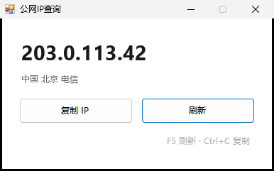

# 公网IP查询

一个几十 KB 的 Windows 小工具：启动即查询本机公网 IP，显示归属地/运营商，一键复制。



> 截图中 IP 与归属地为示例数据。

## 功能

- 启动自动查询，显示公网 IP
- 显示归属地/运营商（来自 ipip.net）
- 一键复制（按钮或 Ctrl+C），F5 刷新
- 多个查询源自动回退：ipip.net → ipify → ipinfo
- 免安装、无运行时依赖，单个 exe

## 使用

从 Releases 下载 `PublicIpQuery.exe`，双击运行即可。

| 操作 | 说明 |
|---|---|
| 启动 | 自动查询并显示公网 IP |
| `复制 IP` / `Ctrl+C` | 复制当前 IP |
| `刷新` / `F5` | 重新查询 |

## 构建

```powershell
.\build.ps1
# 输出：dist\PublicIpQuery.exe
```

依赖 Windows 自带的 .NET Framework 4.8 编译器（`csc.exe`），无需安装 Visual Studio。

## 实现说明

- WinForms 单文件实现，C# / .NET Framework 4.x
- 所有请求走 HTTPS，单次超时 6 秒，失败自动切换下一个来源
- 使用多个来源是为了避免单一服务不可用（尤其是不同网络环境下）
- 未做代码签名，首次运行可能触发 SmartScreen 提示

## 目录结构

```text
src/PublicIpQuery.cs    程序源码（查询服务 + 窗口）
build.ps1               编译脚本
```

## 许可

本项目采用自定义非商业许可：自由复制、修改，禁止商业使用；整合或再分发时必须注明出处（Jon.Shen，Jon.Shen@Foxmail.com）。详见 [LICENSE](LICENSE)。

## 相关工具

- [世界时钟动态壁纸](https://github.com/JonShenzl/world-clock-wallpaper)
- [图片格式转换器](https://github.com/JonShenzl/img-convert-to-jpg)
